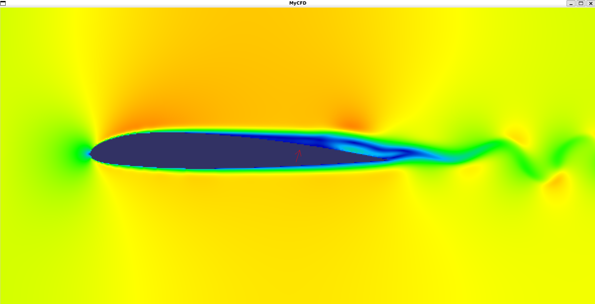
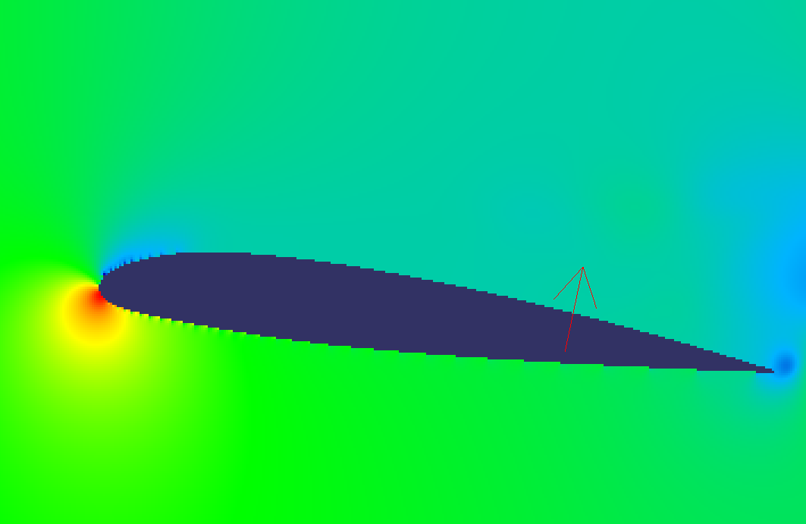

# Welcome to CFD Playground

## About this project

This is a repo for a simple Computational Fluid Dynamics simulation. Built by hand (#novibecoding) as an experiment to see just how far it is possible to push CFD with bare C++ and CUDA.

## Functionality

### Airfoil Generator

Automatically creates airfoils based on the 4-digit NACA format (set manually in `src/main.cpp`). Creates a solid mesh based on the airfoil, allows pitching up or down using arrow keys (<kbd>&uarr;</kbd> and <kbd>&darr;</kbd>).

### Navier-Stokes Solver

Iteratively solves incompressible Navier-Stokes on a MAC grid. Uses CUDA for solving pressure with Jacobi iterations and basic advection.  

Viscosity is being rewritten in CUDA right now and is not available on the GPU yet.


## Requirements

- An NVIDIA GPU with a recent driver
- [CUDA Toolkit](https://developer.nvidia.com/cuda-downloads) (`nvcc` on your `PATH`)
- CMake 3.24 or newer
- A C++20 compiler (GCC on Linux)
- [SFML 3](https://www.sfml-dev.org/) (Graphics, Window, System)
- Ninja (optional, but recommended)

**Platform note:** developed on Ubuntu under WSL2. On Windows, nvcc only supports MSVC as its host compiler, so a MinGW/MSYS2 toolchain will not work. Use WSL2 or a full MSVC setup.

### Installing dependencies (Ubuntu)

```bash
sudo apt install build-essential cmake ninja-build git \
    libx11-dev libxrandr-dev libxcursor-dev libxi-dev libudev-dev \
    libfreetype-dev libgl1-mesa-dev libegl1-mesa-dev libfontconfig1-dev \
    libflac-dev libvorbis-dev libopenal-dev
```

Ubuntu's packaged SFML is usually version 2, so build SFML 3 from source:

```bash
git clone --branch 3.0.0 --depth 1 https://github.com/SFML/SFML.git
cmake -S SFML -B SFML/build -G Ninja -DCMAKE_BUILD_TYPE=Release -DBUILD_SHARED_LIBS=ON
cmake --build SFML/build -j
sudo cmake --install SFML/build
sudo ldconfig
```

## Build

```bash
git clone https://github.com/BAD353/CFD-playground.git
cd CFD-playground
cmake -S . -B build -G Ninja
cmake --build build -j
```

The build defaults to Release. For a debug build (assertions and `gdb` friendly):

```bash
cmake -S . -B build-debug -G Ninja -DCMAKE_BUILD_TYPE=Debug
cmake --build build-debug -j
```

## Run

```bash
./build/CFDSolver
```

Run it from the repository root. Under WSL2 the window opens through WSLg.

### Controls

| Key | Action |
|---|---|
| <kbd>&uarr;</kbd> / <kbd>&darr;</kbd> | Pitch the airfoil up / down |
| <kbd>V</kbd> | Cycle data view (velocity arrows, divergence, pressure, velocity field, empty) |
| <kbd>M</kbd> | Switch mouse mode (interact / build) |
| <kbd>LMB</kbd> | Interact: add velocity by dragging. Build: place walls |
| <kbd>RMB</kbd> | Interact: add dye by dragging. Build: remove walls |
| <kbd>+</kbd> / <kbd>-</kbd> | Increase / decrease brush size |

## Configuration

- **Airfoil:** the NACA 4-digit code is set in `src/main.cpp`.
- **Grid size:** set in `src/main.cpp`.

## Known issues

- Large grids (e.g. 1000×500) currently crash; 600×300 works.
- Viscosity runs on the CPU only (GPU version in progress).
- Coarse grids produce stair-stepped boundaries, which affects flow separation near the airfoil.

## Screenshots



